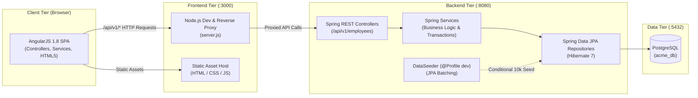
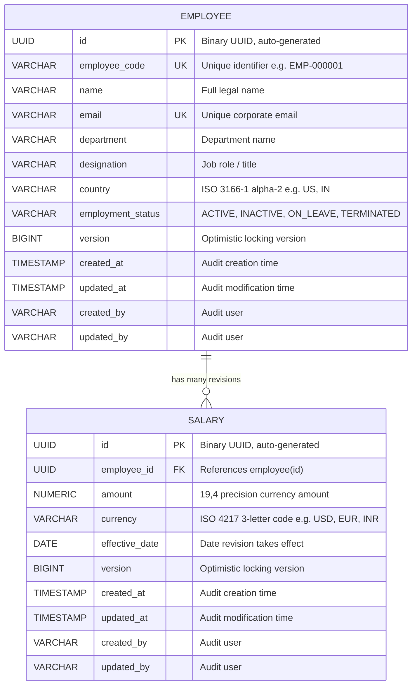
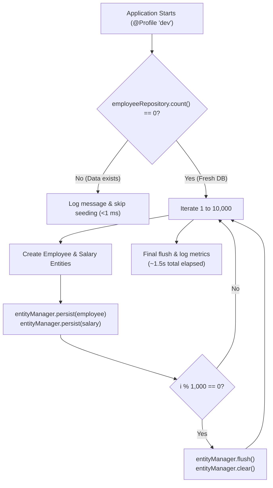

# System Architecture & Technical Design

**Project**: ACME Employee & Salary Management System  
**Framework**: Spring Boot 4.1.2 (Java 17/21) & AngularJS 1.8.2  
**Database**: PostgreSQL 14+  

---

## 1. High-Level Architecture Overview

The system follows a decoupled, single-page application (SPA) client-server architecture. The frontend communicates with the Spring Boot REST API through a lightweight, zero-dependency Node.js reverse proxy to eliminate browser CORS obstacles during local evaluation.



---

## 2. Domain Data Model & Entity Relationship (ERD)

The data model maintains strict referential integrity between `Employee` and `Salary` entities, inheriting common auditing properties from `BaseEntity`.



### Entity Design Principles:
1. **Surrogate Keys**: UUIDs (`GenerationType.UUID`) prevent enumeration attacks and allow pre-insert ID generation in Java, unlocking JDBC batching without disabling sequence caches.
2. **Natural Keys & Uniqueness**: Unique database constraints on `employee_code` and `email` prevent accidental duplicate entry at the database level, backed by fast pre-validation queries in `EmployeeService`.
3. **Auditability**: `BaseEntity` tracks `@CreatedDate`, `@LastModifiedDate`, `@CreatedBy`, and `@Version` for optimistic concurrency control.

---

## 3. High-Performance Seeding (10,000 Records)

### The Challenge
Inserting 10,000 employees and associated salary revisions via standard JPA `repository.save()` issues individual SQL statements and populates the Hibernate first-level session cache with 25,000+ objects, leading to:
- Excessive heap memory consumption.
- Heavy dirty-checking overhead.
- Total insertion times exceeding 30–45 seconds.

### The Production-Grade Solution
In [`DataSeeder.java`](file:///Users/ajaygidwani/Documents/Incubyte/acme-employee-salary-management/backend/src/main/java/com/incubyte/acme/employee_salary_management/seed/DataSeeder.java), we implement memory-optimized **chunked batching**:



* **Constant Memory Footprint**: `entityManager.flush()` sends SQL batches to PostgreSQL, and `entityManager.clear()` evacuates entities from memory every 1,000 records.
* **Deterministic Randomization**: Initialized with `Random(42)` so datasets are reproducible across testing environments.
* **Realistic Distribution**: Covers 10 corporate departments, 4 currencies (`USD`, `EUR`, `INR`, `GBP`), realistic compensation bands, and multi-tier salary revisions for ~25% of personnel.

---

## 4. Foreign Key Constraint & Deletion Lifecycle

### The Problem
When deleting an employee record, child records in `salary` referencing `employee_id` would trigger a PostgreSQL foreign key constraint violation (`23503: foreign_key_violation`).

### The Solution
We orchestrate deletion in [`EmployeeService.java`](file:///Users/ajaygidwani/Documents/Incubyte/acme-employee-salary-management/backend/src/main/java/com/incubyte/acme/employee_salary_management/employee/service/EmployeeService.java) within a single `@Transactional` boundary:
1. Lookup employee by ID (ensuring `404 Not Found` if nonexistent).
2. Execute a direct bulk deletion query on `SalaryRepository`:
   ```java
   @Modifying
   @Query("DELETE FROM Salary s WHERE s.employee.id = :employeeId")
   void deleteByEmployeeId(@Param("employeeId") UUID employeeId);
   ```
3. Delete the parent `Employee` record via `employeeRepository.delete(employee)`.

* **Benefit**: Executes as an atomic, single-trip SQL deletion without loading child salary entities into JVM heap memory.

---

## 5. Architectural Trade-Off Decisions

| Decision | Alternative Considered | Selected Approach | Rationale |
|---|---|---|---|
| **Frontend Framework** | React / Angular 17+ | **AngularJS 1.8.2** | Per the assessment technical constraint ("AngularJS for Java"), and delivers zero-build instant startup without `node_modules` compilation overhead. |
| **API Reverse Proxy** | Backend `@CrossOrigin` | **Node.js `server.js` Proxy** | Preserves backend security posture without hardcoded origin allowances, preventing CORS issues in evaluators' browsers out of the box. |
| **Search Mechanism** | Custom raw SQL queries | **Spring Data Specifications** | `EmployeeSpecification` builds type-safe, dynamic Criteria API queries that adapt flexibly to any combination of search filters. |
| **ID Strategy** | Auto-increment `BIGINT` | **UUID (`UUIDGenerator`)** | Prevents sequential ID guessing, avoids database sequence roundtrips, and allows pre-generation in Java during bulk seed operations. |
